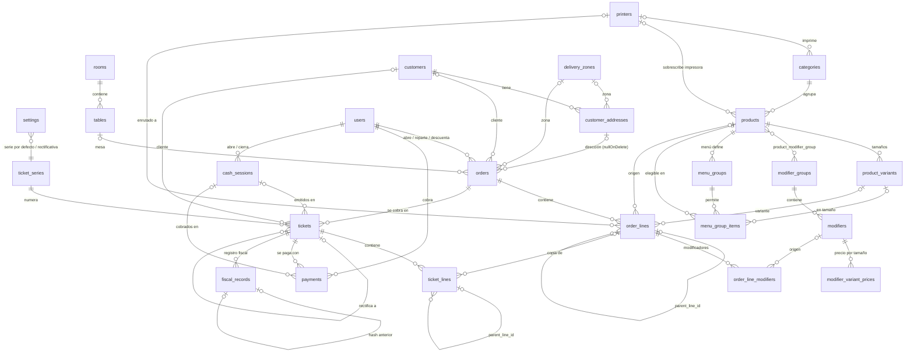

# Modelo de datos del TPV

Modelo para bar/restaurante con mesas y para pizzería con reparto y pedidos
para llevar. Cada local activa sus tipos de pedido en `settings.enabled_order_types`.

## Convenciones

- **Importes**: `integer` en céntimos. Nunca floats (ver `App\Support\Money`).
- **Precios con IVA incluido.** La base y la cuota se calculan hacia atrás
  agrupando por tipo de IVA (no línea a línea) para que el redondeo no descuadre.
- **IVA y porcentajes en puntos básicos**: `1000` = 10 %, `2100` = 21 %.
  Los descuentos de tipo `porcentaje` también: `1500` = 15 %.
- **Redondeo**: medio céntimo hacia arriba. Al repartir un importe, cada parte
  se trunca y el resto va a la parte de mayor importe (`Money::allocate`).
- **Identificadores en inglés** (tablas, columnas, clases); **valores de enum en
  español** (`mesa`, `para_llevar`, `efectivo`…), que son los que se guardan.
- **Snapshots**: líneas de pedido y de ticket copian nombre, variante, precio,
  IVA aplicado y modificadores. El pedido a domicilio copia nombre, teléfono y
  dirección del cliente. Las FK al catálogo son `nullOnDelete`.
- Enums en `app/Enums`. Servicios de dominio en `app/Services`.

## Diagrama ER



## Tablas

### Configuración y personal

| Tabla | Campos | Notas |
|---|---|---|
| `settings` | `trade_name`, `legal_name`, `tax_id`, `address`, `postal_code`, `city`, `province`, `phone`, `email`, `ticket_footer`, `logo_path`, `enabled_order_types` (json `OrderType[]`), `default_ticket_series_id`, `rectifying_ticket_series_id`, `half_and_half_pricing` (`mas_cara`\|`media`), `half_and_half_modifier_pricing` (`entero`\|`mitad`), `delivery_fee_vat_rate` | Una sola fila: `Setting::current()`. |
| `ticket_series` | `code` (único), `name`, `digits` (cifras del número, 6 por defecto, mínimo 5), `is_rectifying`, `is_active` | |
| `ticket_series_counters` | `ticket_series_id`, `year`, `last_number` (único por serie y año) | Contador por serie y año natural; su fila se bloquea para numerar. |
| `z_counters` | `year` (clave), `last_number` | Contador de cierres Z por año. |
| `users` | + `role` (`admin`\|`encargado`\|`camarero`\|`repartidor`), `pin` (hash), `is_active`; `email` pasa a nullable | Filament: solo admin/encargado activos. PIN de 4 dígitos validado en el mutador. |

### Sala

| Tabla | Campos |
|---|---|
| `rooms` | `name`, `sort_order`, `is_active` |
| `tables` | `room_id`, `name`, `seats`, `pos_x`, `pos_y`, `width`, `height`, `shape` (`cuadrada`\|`redonda`), `status` (`libre`\|`ocupada`\|`cuenta_pedida`\|`fuera_servicio`), `is_active` |

> **Regla:** `tables.status` **solo lo cambian los servicios de pedidos**
> (`App\Services\Orders\OrderService`: al abrir un pedido de mesa la ocupa; al
> cerrarlo o cancelarlo la libera si no le quedan pedidos abiertos). Ni
> controladores, ni Filament, ni la SPA deben escribirlo directamente. Así el
> estado de la mesa siempre es coherente con sus pedidos.

### Carta

| Tabla | Campos |
|---|---|
| `printers` | `name`, `type` (`ticket`\|`cocina`\|`barra`), `host`, `port`, `columns` (48/32), `codepage`, `profile`, `is_active` |
| `categories` | `name`, `color`, `sort_order`, `printer_id`, `is_active`, soft deletes |
| `products` | `category_id`, `name`, `short_name`, `price`, `vat_rate`, `vat_rate_takeaway` (nullable), `printer_id` (sobrescribe la de la categoría), `type` (`simple`\|`variantes`\|`menu`), `allows_half_and_half`, `allergens` (json, enum `Allergen`), `is_active`, `is_available` (agotado temporal), `sort_order`, soft deletes |
| `product_variants` | `product_id`, `code`, `name`, `price`, `sort_order`, `is_active`; único (`product_id`, `code`) |
| `modifier_groups` | `name`, `min_select`, `max_select` (null = sin límite), `sort_order` |
| `modifiers` | `modifier_group_id`, `name`, `price_delta`, `sort_order`, `is_active` |
| `modifier_variant_prices` | `modifier_id`, `variant_code`, `price_delta` |
| `product_modifier_group` | `product_id`, `modifier_group_id`, `sort_order` |
| `menu_groups` | `product_id` (el menú), `name`, `min_select`, `max_select`, `sort_order` |
| `menu_group_items` | `menu_group_id`, `product_id`, `product_variant_id`, `supplement`, `sort_order` |

Alérgenos (`App\Enums\Allergen`, Reglamento UE 1169/2011): gluten, crustáceos,
huevos, pescado, cacahuetes, soja, lácteos, frutos de cáscara, apio, mostaza,
sésamo, sulfitos, altramuces, moluscos.

### Clientes y reparto

| Tabla | Campos |
|---|---|
| `delivery_zones` | `name`, `delivery_fee`, `minimum_order`, `postal_codes` (json), `is_active` |
| `customers` | `phone` (E.164, único, nullable), `name`, `notes`, `orders_count`, `last_order_at`, `anonymized_at` |
| `customer_addresses` | `customer_id`, `label`, `street`, `number`, `floor_door`, `postal_code`, `city`, `instructions`, `delivery_zone_id`, `is_default` |

### Pedidos

| Tabla | Campos |
|---|---|
| `orders` | `type` (`mesa`\|`barra`\|`para_llevar`\|`domicilio`), `status` (`abierto`\|`cerrado`\|`cancelado`\|`unido`), mesas unidas (`merged_into_order_id`, `merged_by`, `merged_at`), cancelación (`cancelled_at`, `cancelled_by`, `cancel_reason`), `table_id` (solo mesa), `opened_by`, `guests`, `customer_id`, `customer_address_id` (**nullOnDelete**), snapshot `customer_name`, `customer_phone`, `delivery_address` (json), `delivery_zone_id`, `promised_at`, `courier_id`, `delivery_status` (`pendiente`\|`en_cocina`\|`en_reparto`\|`entregado`), `planned_payment_method`, `cash_change_for`, `delivery_fee`, descuento global (`discount_type`, `discount_value`, `discount_amount`, `discount_reason`, `discounted_by`), caché `subtotal` y `total`, `notes`, `opened_at`, `closed_at` |
| `order_tables` | Mesas del pedido (mesas unidas): `order_id`, `table_id`, `is_main` (= `orders.table_id`), `joined_by`, `joined_at`, `left_by`, `left_at`. No se borran; una mesa solo puede estar unida a un grupo a la vez (índice único parcial). |
| `order_lines` | `order_id`, `parent_line_id`, `kind` (`normal`\|`menu_componente`\|`mitad`), `product_id`, `product_variant_id`, `printer_id`; snapshot `name`, `variant_name`, `variant_code`, `unit_price`, `vat_rate` (tipo **aplicado**), `reference_price`, `allocated_amount`, `quantity`; descuento (`discount_type`, `discount_value`, `discount_amount`, `is_invitation`, `discount_reason`, `discounted_by`); calculados `line_total`, `order_discount_amount`, `taxable_amount`; `notes`, `course` (1 primeros, 2 segundos, 3 postres), `sort_order`, `created_by`, `sent_at`, `fired_at`, `voided_at`, `void_reason`, `voided_by` |
| `order_line_modifiers` | `order_line_id`, `modifier_id`, snapshot `name` y `price_delta` (ya según tamaño), `quantity` |

### Fiscal y caja

| Tabla | Campos |
|---|---|
| `tickets` | `ticket_series_id`, `series_code`, `year` (año natural de emisión, hora de Madrid), `number`, `full_number` (snapshot `T-26-000123`; único (serie, año, número)), `type` (`simplificada`\|`rectificativa`), `status` (`emitido`\|`rectificado`), `order_id`, `order_type` (copia), `cash_session_id`, `issued_by`, `issued_at`, `rectified_ticket_id`, `rectification_method` (`sustitucion`\|`diferencias`), `rectification_reason`, `subtotal`, `lines_discount`, descuento global (`discount_type`, `discount_value`, `discount_amount`, `discount_reason`), `delivery_fee`, `tax_base`, `tax_amount`, `total`, `vat_breakdown` (json `[{rate, base, tax, total}]`), `issuer` (json), `customer_id`, `customer` (json), `delivery_address` (json), `payment_status` (`pagado`\|`pendiente`), `paid_at` |
| `ticket_lines` | Copia de `order_lines` (incluida la jerarquía): `ticket_id`, `parent_line_id`, `order_line_id`, `kind`, `name`, `variant_name`, `quantity`, `unit_price`, `vat_rate`, `reference_price`, `allocated_amount`, `modifiers` (json), descuentos, `order_discount_amount`, `line_total`, `taxable_amount`, `sort_order` |
| `payments` | `ticket_id`, `method` (`efectivo`\|`tarjeta`\|`bizum`\|`otro`), `amount`, `tendered`, `change`, `user_id`, `cash_session_id`, `paid_at` |
| `cash_sessions` | `z_number`, `z_year`, `z_full_number` (`Z-26-0001`, correlativo por año; único (año, número)), `status`, `opened_by`, `opened_at`, `opening_float`, `closed_by`, `closed_at`, `expected_cash`, `counted_cash`, `difference`, `notes` |
| `fiscal_records` | `ticket_id`, `record_type` (`alta`\|`anulacion`), `hash`, `previous_hash`, `previous_record_id`, `generated_at`, `payload`, `submission_status` (`pendiente`\|`enviado`\|`aceptado`\|`aceptado_con_errores`\|`rechazado`), `aeat_response`, `aeat_csv`, `submitted_at`, `attempts` |

## Cómo se modelan las piezas delicadas

### Modificadores

Grupos reutilizables asignados a productos con pivote (`Punto de la carne`
mín. 1 máx. 1, `Ingredientes extra` mín. 0 máx. 5). En el pedido se guardan
en `order_line_modifiers` con snapshot; en el ticket como json en la línea.
El precio aplicado es el de `modifier_variant_prices` para el tamaño de la
línea si existe, o el `price_delta` general. `OrderLineBuilder` valida que los
modificadores sean de grupos del producto y respeten mínimos y máximos.

### Menús / combos

Un menú es un `product` de tipo `menu` con sus `menu_groups` y, en cada grupo,
los `menu_group_items` elegibles (con variante y suplemento opcionales).

En el pedido: **línea padre** con el precio del menú y **líneas hijas**
`menu_componente`, una por producto elegido, con:

- `unit_price` = suplemento (normalmente 0),
- `reference_price` = precio suelto del producto en la variante elegida,
- `vat_rate` = tipo del componente según el tipo de pedido,
- `printer_id` propio (la bebida a barra, la pizza a cocina),
- sus propios modificadores.

**IVA**: el precio del menú se reparte entre los componentes en proporción a
`reference_price × cantidad`. El resto de redondeo va al componente de mayor
importe. La parte asignada se guarda en `allocated_amount` (por unidad de menú),
y cada parte tributa al tipo de su componente. Los suplementos y los modificadores
de una hija tributan al tipo de esa hija. Las cantidades de las hijas son **por
unidad del padre**.

Ejemplo (test `test_delivery_menu_splits_price_across_component_vat_rates`):
menú de 10,00 € a domicilio con pizza (suelta 9,00 €, IVA 10 %) y cerveza
(suelta 2,50 €, 21 % para llevar, +0,50 € de suplemento) → pizza 7,83 € al 10 %
y cerveza 2,17 € + 0,50 € al 21 %.

### Mitad y mitad

Línea padre (sin producto, nombre "Mitad y mitad: A / B") y dos hijas `mitad`.
Ambos productos deben admitirlo y tener la misma variante (`product_variants.code`).
El precio del padre sale de `settings.half_and_half_pricing`:

- `mas_cara`: el precio de la mitad más cara en ese tamaño;
- `media`: la media (medio céntimo hacia arriba).

Ese precio se reparte entre las mitades igual que en los menús (proporcional a
su precio suelto, resto a la mayor), así cada mitad tributa a su tipo y se
enruta a su impresora. Los extras de cada mitad se cobran enteros o a mitad de
precio según `settings.half_and_half_modifier_pricing`.

### Descuentos e invitaciones

- **De línea** (`order_lines`): `porcentaje` o `importe` sobre el bruto de la línea
  completa (incluidas sus hijas), o invitación (`is_invitation`: descuento = bruto).
  Se reparte entre las partes de la línea en proporción a su importe.
- **Global** (`orders`): sobre el subtotal ya descontado, repartido entre todas
  las partes en proporción a su importe (`order_discount_amount`). No afecta a
  los gastos de envío.
- El IVA se calcula **sobre los importes ya descontados**. `taxable_amount` de
  cada línea es lo que tributa a su `vat_rate` tras todos los descuentos, así
  que `Σ taxable_amount por tipo + envío` = desglose del ticket.

### IVA según tipo de pedido

`products.vat_rate_takeaway` (nullable): en `para_llevar` y `domicilio`, si el
producto lo tiene, se aplica ese tipo (alcohol al 21 % para llevar frente al
10 % de servicio de restauración en el local). La línea guarda el tipo
realmente aplicado. Los gastos de envío tributan a `settings.delivery_fee_vat_rate`.

## Reglas e invariantes

| Regla | Dónde |
|---|---|
| Numeración correlativa sin huecos ni duplicados por serie y año (art. 6.1.a RD 1619/2012) | `TicketNumberService`: `SELECT … FOR UPDATE` del contador (serie, año) dentro de la transacción de emisión; si falla, el rollback deshace el contador. Clave única (`ticket_series_id`, `year`, `number`). Formato `{SERIE}-{AA}-{NNNNNN}` (`App\Support\DocumentNumber`), guardado en `full_number`. |
| Tickets inmutables | Modelo `Ticket`/`TicketLine` (eventos `updating`/`deleting`) **y** trigger PostgreSQL `tpv_ticket_guard`. Solo pueden cambiar `payment_status`, `paid_at` y `status` de `emitido` a `rectificado`. |
| Pedido editable solo abierto | `OrderLineBuilder` y `OrderService`. |
| `table_id` solo en pedidos de mesa | Modelo `Order` (evento `saving`) y `OrderService::open`. |
| Estado de mesas | Solo `OrderService`. Con mesas unidas, todas las del grupo tienen el mismo estado; al cobrar o cancelar quedan libres las que no tengan otra cuenta. |
| Mesas unidas | `OrderService::joinTables/separateTables` con `lockForUpdate` del pedido, de todas las mesas (en orden de id) y de los pedidos que se unen. `move` mueve solo la mesa principal. |
| Cobro posterior y pagos mixtos | `PaymentService`: al cubrir el total marca el ticket `pagado`. |
| Número de Z correlativo | `CashSessionService::close` con bloqueo de `settings`. |
| Teléfono normalizado | Mutador de `Customer` + `PhoneNormalizer` (+34, 0034, espacios…). |
| Protección de datos | `CustomerPrivacyService::export/anonymize`. Anonimizar borra direcciones (las FK de pedidos son `nullOnDelete`) y las copias en pedidos; **los tickets conservan su snapshot** (documento fiscal). Ninguna FK impide anonimizar: no se borra el cliente, solo sus datos. |

## Preparación para VeriFactu (sin implementar)

- Numeración correlativa por serie y año natural (vuelve a 1 el 1 de enero, hora de Madrid) y serie separada para rectificativos. En VERI*FACTU, NumSerieFactura = `full_number`.
- Desglose de IVA (`vat_breakdown`), datos del emisor (`issuer`) y del cliente
  congelados en el ticket.
- `fiscal_records` reservada para el encadenamiento (hash, hash anterior,
  fecha-hora de generación, estado de envío, respuesta y CSV de la AEAT).
- `tickets.rectification_method` (`sustitucion` | `diferencias`) y `rectified_ticket_id`.

## Datos de demo

```bash
./vendor/bin/sail artisan migrate:fresh --seed                          # DEMO_DATASET del .env (bar por defecto)
./vendor/bin/sail artisan migrate:fresh --seeder=DemoPizzeriaSeeder     # pizzería
./vendor/bin/sail artisan migrate:fresh --seeder=DemoBarSeeder          # bar
```

| | Bar | Pizzería |
|---|---|---|
| Tipos de pedido | mesa, barra | para llevar, domicilio |
| Sala | 2 salas, 12 mesas | — |
| Carta | 40 productos (tapas, raciones, postres, cervezas, vinos, refrescos, cafés, copas) | 12 pizzas mediana/familiar (11 con mitad y mitad), extras con precio por tamaño, 4 entrantes, 8 bebidas, 4 postres, 2 menús |
| Modificadores | Punto de la carne (obligatorio), Leche, Salsa | Ingredientes extra, Quitar ingredientes, Masa |
| Impresoras | Barra, Cocina, Caja | Cocina, Mostrador (58 mm) |
| Personal (PIN) | Ana 1111, Luis 2222, Marta 3333 | Carlos 1111 (mostrador), Javi 4444 y Sara 5555 (reparto) |
| Clientes | — | 15 clientes, 1-2 direcciones, 3 zonas |

En ambos: admin `admin@tpv.test` (PIN 0000) y encargado `encargado@tpv.test`
(PIN 9999), contraseña `admin1234`. **Solo desarrollo.**
